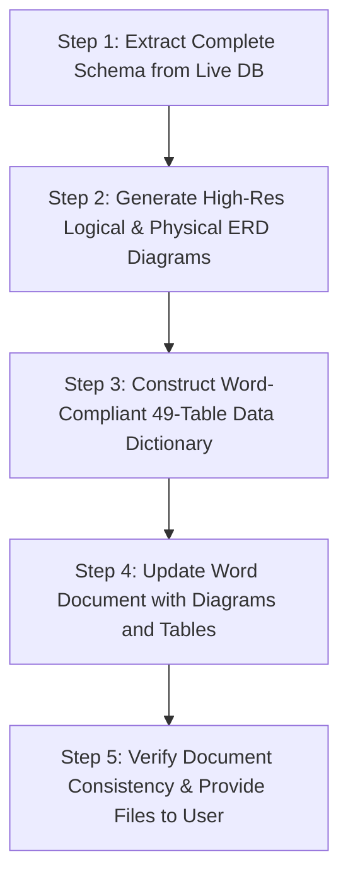

# Implementation Plan: Database Design & Documentation Synchronization

Comprehensive database design synchronization for **PCC Home Suite Home (Pension House Management System)**, aligning the academic capstone documentation (`GRUOP4_Web_Based_Pension_House_Management_System_for_PCC_Home_Suite (2) (1).docx`) with the live system database.

---

## 1. Database Access Confirmation

Direct live connection to the system's database has been verified:
- **Engine**: MySQL / TiDB Serverless (`test` database)
- **Active Tables**: **49 tables** currently live and operational
- **Word Document Baseline**: **32 tables** (Tables 98 to 129 in Chapter 3/4)
- **Gap Identified**: **17 missing tables** and dozens of updated attributes, foreign keys, and constraints across existing tables.

---

## 2. Gap Analysis: Word Document vs. Live Database

### A. Missing Tables in Document (17 New Entities)
The following tables are actively used by the web application but missing from the capstone document:

| # | Entity / Table Name | Purpose in System |
|---|---------------------|-------------------|
| 1 | `booking_discount` | Per-capita guest discount tracking (Senior, PWD, Promo codes, IDs) |
| 2 | `booking_guest_details` | Multi-guest check-in roster per booking (names, ages, discount IDs) |
| 3 | `booking_incidentals` | Damage / missing item incidental records tied to bookings |
| 4 | `incidental_charge` | Financial line items for room damages and extra usage fees |
| 5 | `borrow_transaction` | Lending operations for hotel amenities (irons, adaptors, extra towels) |
| 6 | `inquiry` | Public guest inquiries submitted from the guest portal |
| 7 | `inquiry_message` | Real-time / threaded messaging between guests, chatbot, and receptionists |
| 8 | `inventory_batch` | FIFO batch stock tracking (batch numbers, supplier, expiry dates, unit cost) |
| 9 | `inventory_disposal` | Wastage / disposal logs (expired, damaged, contaminated, lost) |
| 10 | `inventory_movement` | Granular audit trail for all stock in / out / borrow / return / disposal |
| 11 | `purchase_order_delivery` | Receiving records tracking partial/full supplier deliveries per PO item |
| 12 | `notification` | Push notifications and alerts for receptionists, admins, and guests |
| 13 | `system_settings` | Dynamic operational configurations (VAT 12%, breakfast fees, hotel policies) |
| 14 | `system_audit` | Comprehensive activity logging for administrative governance |
| 15 | `billing_audit` | Ledger audit logging for manual financial adjustments and balances |
| 16 | `uploaded_files` | File storage metadata for payment receipts, valid IDs, and avatars |
| 17 | `PaymentHistory` | Historical transaction audit logs for payment reconciliations |

### B. Table Name Normalization
- Document has `order` &rarr; System uses `orders` (avoids SQL reserved keyword conflicts)
- Document has `transaction` &rarr; System uses `transactions`

### C. Attribute Discrepancies in Existing 32 Tables
- **`user`**: Added `sessionToken`, `suspendedUntil`, `suspensionRemarks`, `isDeleted`.
- **`room`**: Added `description`, `occupancyLimit`, `image`, `isArchived`.
- **`guest`**: Updated for walk-in guest flexibility (nullable `userID`, `gender`, `dateOfBirth`, `city`, `province`, `email`).
- **`booking`**: Added 3NF financial summary fields (`subtotal`, `discountTotal`, `netTotal`, `vatRate`, `vatAmount`, `grandTotal`), `breakfastID` FK, `breakfastDates` (JSON), `breakfastFee`, `guestCount`, `cancelRemarks`, and `billFinalizedAt`.
- **`billing`**: Added detailed accounting fields (`subtotal`, `discountTotal`, `netTotal`, `vatRate`, `vatAmount`, `grandTotal`, `missingAmenitiesFee`, `reservationID`, `billingStatus`, `isBillFinalized`).
- **`products` & `amenities`**: Added inventory controls (`itemType` enum: Consumable/Non-Consumable, `unit`, `minStock` threshold, `isArchived`, `isAvailable`, `description`).
- **`purchase_order` & `purchase_order_items`**: Added `expectedDeliveryDate`, `remarks`, `quantityReceived`.
- **`order_product` & `order_amenities`**: Added `unitPrice`, `isComplimentary`.
- **`reservation`**: Added `checkOutDateTime`, `guestCount`, `specialRequests`, `breakfastOption`, `breakfastDates`, `breakfastFee`.
- **`payment`**: Added `changeAmount`.

---

## 3. Deliverables & Proposed Design Architecture

### Deliverable 1: High-Resolution Visual Database Models (Images)
1. **Logical Database Model (Figure 343)**:
   - High-level Entity-Relationship diagram highlighting business domains (Core Hotel Operations, Guest & Account Management, Inventory & Supply Chain, Billing & Accounting, Audit & Notifications).
   - Clear cardinalities (1:1, 1:N, M:N through associative entities).
   - Display of Primary Keys (PK) and Foreign Keys (FK).
2. **Physical Database Model (Figure 344)**:
   - Detailed relational schema diagram showing all 49 tables.
   - Exact MySQL/TiDB data types (`INT(11)`, `VARCHAR(n)`, `DECIMAL(10,2)`, `ENUM(...)`, `JSON`, `DATETIME`, `TINYINT(1)`).
   - Key indicators (`PK`, `FK`), Nullability (`NOT NULL` / `NULL`), Default values, and Foreign Key constraint connection lines.

### Deliverable 2: Complete Data Dictionary (Word Document Formatting)
Every table will follow the **exact format** used in the original document:
```
+-------------------------------------------------------------------------------------------------------------------------+
| Table Name    | <TABLE_NAME>                                                                                            |
| Description   | <Clear functional explanation of the table's purpose>                                                  |
| Alias         | <PascalCase Entity Name>                                                                                |
+---------------+-------------+-----------+---------------+-------------+---------+-------------+-------------------------+
| Attribute Name| Description | Data Type | Default Value | Primary Key | Example | Constraints | Validation Rule         |
+---------------+-------------+-----------+---------------+-------------+---------+-------------+-------------------------+
| ...           | ...         | ...       | ...           | True/False  | ...     | PK/FK/NN    | Regex or type rule      |
+---------------+-------------+-----------+---------------+-------------+---------+-------------+-------------------------+
Caption: Table <N>. Data Dictionary for <EntityName>
```

### Deliverable 3: Word Document Generation / Update
- Update `GRUOP4_Web_Based_Pension_House_Management_System_for_PCC_Home_Suite (2) (1).docx` (creating an updated version `GRUOP4_Web_Based_Pension_House_Management_System_for_PCC_Home_Suite_Updated_DB_Design.docx` to preserve the original as safe backup).
- Update Figure 343 (Logical Database Model) and Figure 344 (Physical Database Model) with the newly generated high-resolution diagrams.
- Replace/expand Tables 98 to 129 to include all 49 tables (Tables 98 through 146) with consecutive, uninterrupted academic numbering and consistent typography.

---

## 4. Execution Steps



- **Phase 1: Visual Model Generation**
  - Generate standalone high-res images for:
    - `logical_database_model.png`
    - `physical_database_model.png`
  - Ensure diagrams are clean, organized into functional clusters, and clearly legible.

- **Phase 2: Word Document Preparation**
  - Construct the complete XML / docx payload containing all 49 formatted tables.
  - Apply exact XML styles (font, borders, padding, shading, and cell dimensions).
  - Embed the generated logical and physical ERD diagram images at Figure 343 and Figure 344.

- **Phase 3: Verification & Deliverable Handover**
  - Verify that all 49 tables, fields, constraints, and relationships match the actual code and live database.
  - Provide direct download paths for the generated `.docx` file and the standalone image files.

---

## 5. Verification Plan

1. **Schema Parity Check**: Validate that every column in `live_db_schema.json` is represented in the updated Data Dictionary.
2. **Diagram Integrity Check**: Verify that all foreign keys and associative relations match the actual table relationships in the codebase (`lib/db.js`, `database/migrate.mjs`).
3. **Word Document Validation**: Verify that the generated `.docx` opens cleanly without corruption, maintaining existing document formatting, headers, footers, and table numbering.
